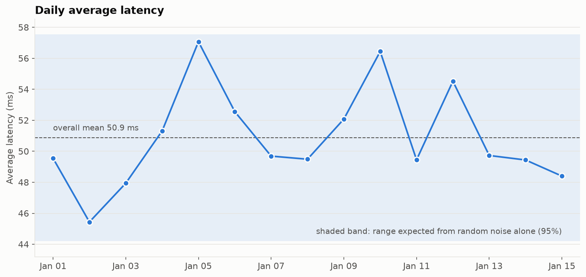
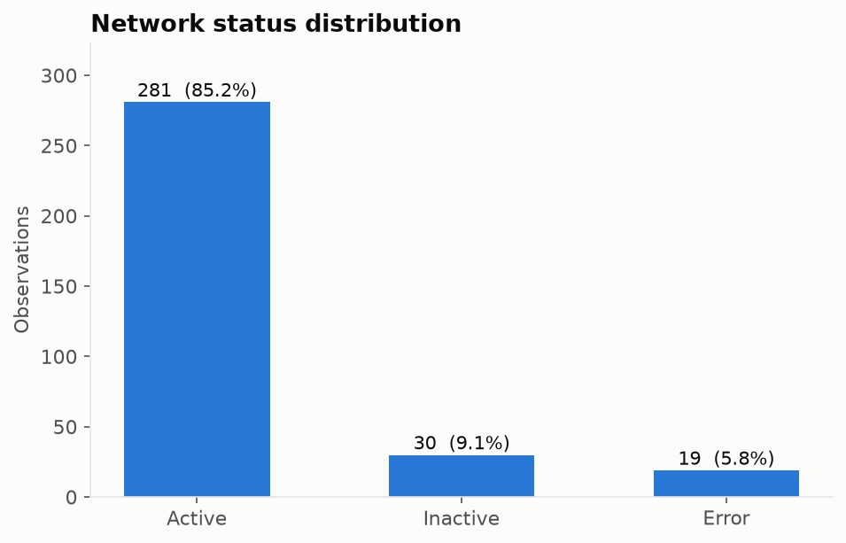
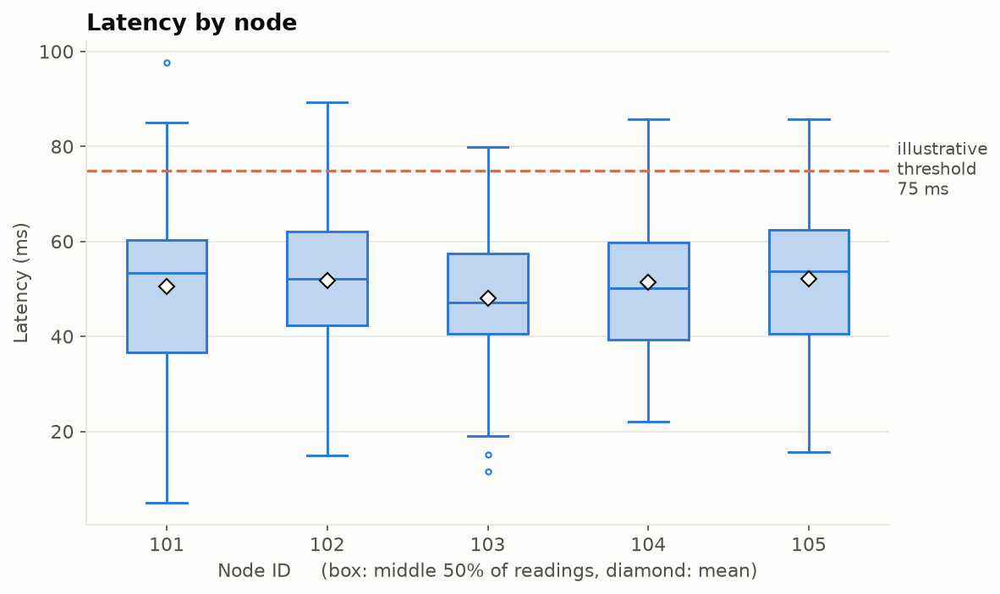
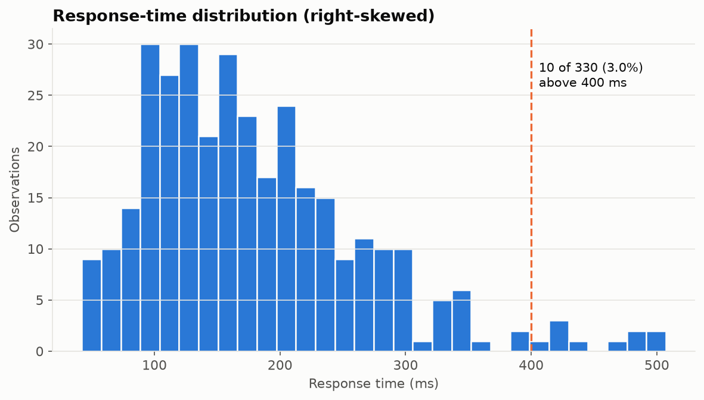
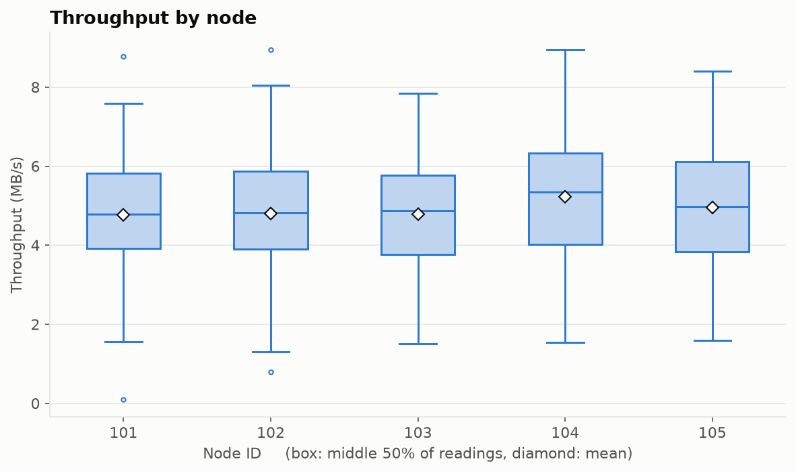

# Network Performance Analysis: SQL, KPIs and Visualization

## Overview

This project analyzes **simulated** network performance data with Python, Pandas, SQLite and statistical tests. It demonstrates an end-to-end analytics workflow: loading time-stamped records, validating them, summarizing them with SQL, computing KPIs, testing whether differences between nodes are real, and communicating the results with charts.

> **Note:** the data is simulated and is not collected from a live network. The analysis shows a workflow, not conclusions about any real infrastructure.

## Objectives

- Track latency over time.
- Examine the distribution of node status (Active, Inactive, Error).
- Compare latency, response time and throughput across nodes.
- Summarize performance with KPIs (availability, error rate, p95 latency, SLA breaches).
- Use SQL to aggregate and explore the data.
- Test whether apparent differences between nodes are statistically meaningful.

## Dataset

`data/simulated_network_data.csv` contains **330 records** from **5 nodes (101-105)**, covering **2026-01-01 01:47 to 2026-01-15 08:14**. Observations are irregular: the gap between records is 5-120 minutes (median 64). There are no missing values or duplicate rows.

| Column | Description |
|---|---|
| `timestamp` | Date and time of the observation |
| `node_id` | Identifier of the simulated node (101-105) |
| `latency_ms` | Latency in milliseconds |
| `response_time_ms` | Response time in milliseconds (latency plus a processing delay) |
| `throughput_MBps` | Throughput in megabytes per second |
| `status` | `Active`, `Inactive` or `Error` |

### How the data was generated

`notebooks/generate_simulated_data.ipynb` creates the CSV with a fixed seed (42), so it is reproducible. Every column is drawn **independently**:

| Column | Distribution |
|---|---|
| `timestamp` | Starts 2026-01-01; gaps uniform between 5 and 120 minutes |
| `node_id` | Uniform choice from 101-105 |
| `latency_ms` | Normal(mean 50, sd 15), clipped to 5-150 |
| `response_time_ms` | `latency_ms` + Gamma(shape 2, scale 60) |
| `throughput_MBps` | Normal(mean 5, sd 1.5), floored at 0.1 |
| `status` | Active 85% / Inactive 10% / Error 5% |

Because nothing is linked across columns, **no real node or time effects exist in this data** - which makes it a useful check that the analysis does not invent patterns.

## Tools

Python, Pandas, NumPy, SciPy, Matplotlib, Seaborn, SQLite, Jupyter.

## Methodology

1. **Load** the CSV into SQLite and read it back with SQL.
2. **Inspect** structure, missing values, duplicates, time span and sampling gaps.
3. **Validate and flag.** Only impossible records would be removed (bad timestamps, non-positive values, unknown status, response time below latency) - none were found, so all 330 rows are kept. Breach flags are added instead of deleting data: latency above 75 ms and response time above 400 ms (both *illustrative* thresholds, configurable at the top of the notebook).
4. **SQL analysis:** per-node summary, status distribution, daily average latency.
5. **KPIs:** availability, error rate, averages and 95th percentiles, SLA breach rates.
6. **Statistical tests:** Kruskal-Wallis (measures across nodes), chi-square (status mix by node), Mann-Whitney U (latency of Active vs Error records).
7. **Visualization:** five charts saved to `images/`.

> An earlier version of this notebook deleted rows with response time above 400 ms. Response time is naturally long-tailed, so those rows were legitimate slow requests; they are now flagged and kept.

## Results

### KPI summary

| KPI | Value |
|---|---|
| Observations | 330 |
| Availability (status = Active) | 85.15% |
| Inactive rate | 9.09% |
| Error rate | 5.76% |
| Average latency | 50.87 ms |
| p95 latency | 78.63 ms |
| Average response time | 180.20 ms |
| p95 response time | 339.87 ms |
| Average throughput | 4.91 MB/s |
| Latency above 75 ms | 7.58% of observations |
| Response time above 400 ms | 3.03% of observations (10 records) |

### Per-node summary

| Node | Records | Avg latency (ms) | Avg response (ms) | Avg throughput (MB/s) | Availability | Error rate |
|---|---|---|---|---|---|---|
| 101 | 68 | 50.47 | 189.15 | 4.77 | 88.2% | 4.4% |
| 102 | 67 | 51.85 | 173.34 | 4.80 | 85.1% | 4.5% |
| 103 | 57 | 47.99 | 168.86 | 4.79 | 80.7% | 3.5% |
| 104 | 67 | 51.47 | 176.62 | 5.22 | 86.6% | 7.5% |
| 105 | 71 | 52.09 | 190.56 | 4.96 | 84.5% | 8.5% |

### Are the node differences real?

| Comparison | Test | p-value | Significant at 5%? |
|---|---|---|---|
| Latency by node | Kruskal-Wallis | 0.646 | No |
| Response time by node | Kruskal-Wallis | 0.570 | No |
| Throughput by node | Kruskal-Wallis | 0.501 | No |
| Status mix by node | Chi-square* | 0.582 | No |
| Latency: Active vs Error | Mann-Whitney U | 0.116 | No |

\*Some expected counts are below 5, so the chi-square result is approximate.

**Reading the results:** node 105 has the highest average latency (52.09 ms) and node 103 the lowest (47.99 ms), but the 4.10 ms gap is small against a latency standard deviation of about 16 ms and is not statistically significant. The same is true of the higher error rates on nodes 104 and 105. Daily average latency stays inside the range expected from random variation on all 15 days. This matches how the data was generated (independent columns), so the analysis correctly finds no structure.

### Charts

| | |
|---|---|
|  |  |
|  |  |
|  | |

## Project Structure

```text
network-data-analysis/
├── README.md
├── LICENSE
├── requirements.txt
├── .gitignore
├── data/
│   └── simulated_network_data.csv
├── notebooks/
│   ├── generate_simulated_data.ipynb
│   └── network_analysis.ipynb
└── images/
    └── *.png
```

The SQLite database (`data/network_data.db`) is recreated each time the analysis notebook runs and is excluded from version control.

## Limitations

- The data is simulated, with independent columns; it contains no real node, time or failure patterns.
- The SLA thresholds (75 ms latency, 400 ms response time) are illustrative, not industry standards.
- Only 330 records over 15 days: per-node error counts are small (2-6), so error-rate comparisons are unreliable.
- The first and last days are partial (the last day has 10 observations), so daily averages are noisier at the edges.
- The analysis is descriptive and does not establish causes; there is no live monitoring or alerting.

## Potential Improvements

- Regenerate the data with node-specific baselines, errors correlated with high latency, and a planted degraded period, then confirm the analysis detects them.
- Add anomaly detection (for example rolling mean plus 3 standard deviations) and per-node hourly KPIs.
- Build an interactive dashboard with Streamlit or Power BI.
- Test the workflow on real or public network telemetry from an authorized source.
- Add automated data-validation tests and reusable SQL reporting queries.

## Skills Demonstrated

Python, Pandas, SQL and SQLite, data validation, KPI design, statistical testing (Kruskal-Wallis, chi-square, Mann-Whitney), data visualization, and technical documentation.
